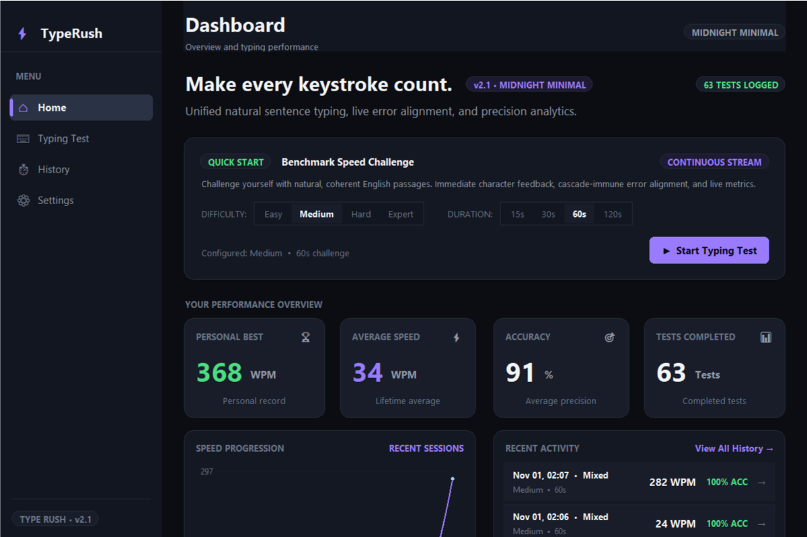
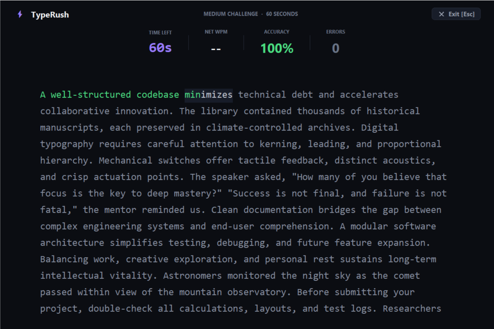
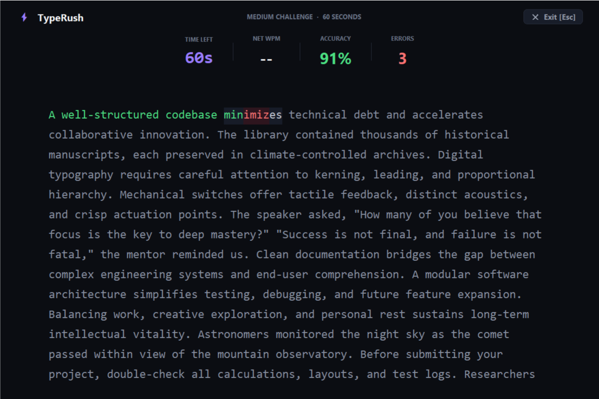
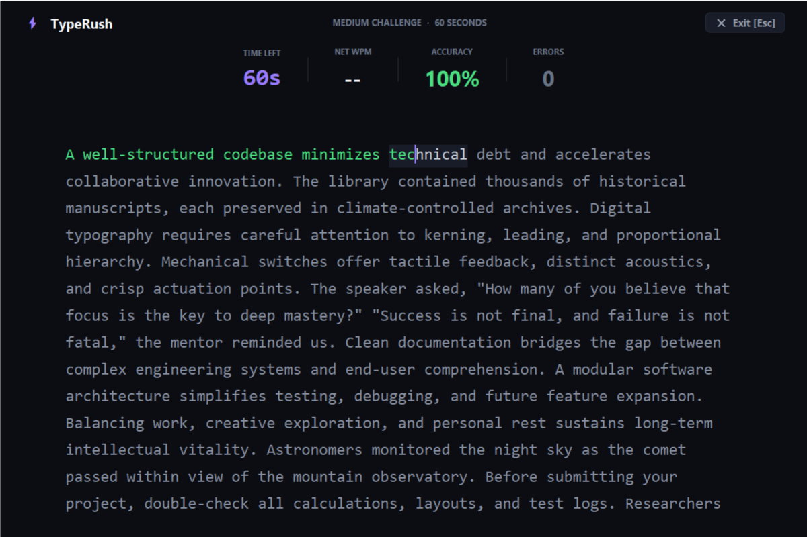
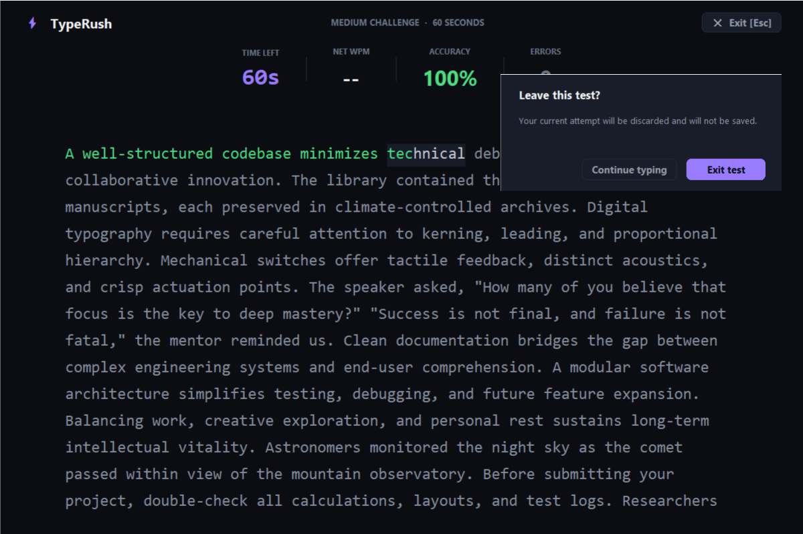
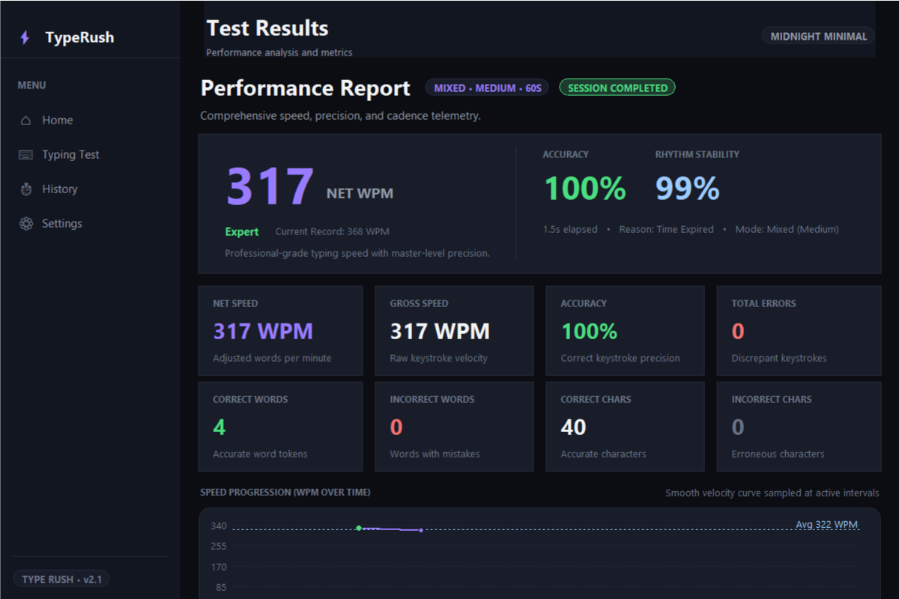
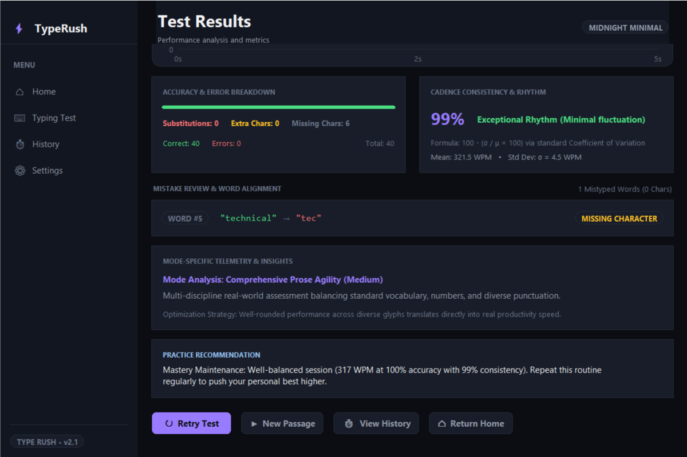
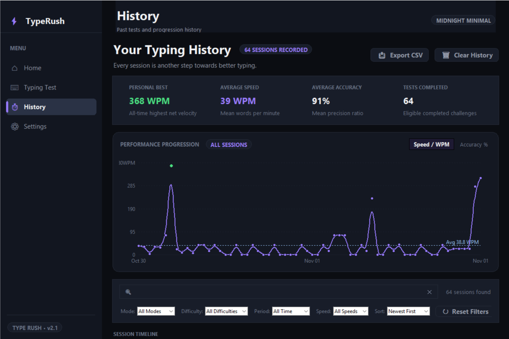
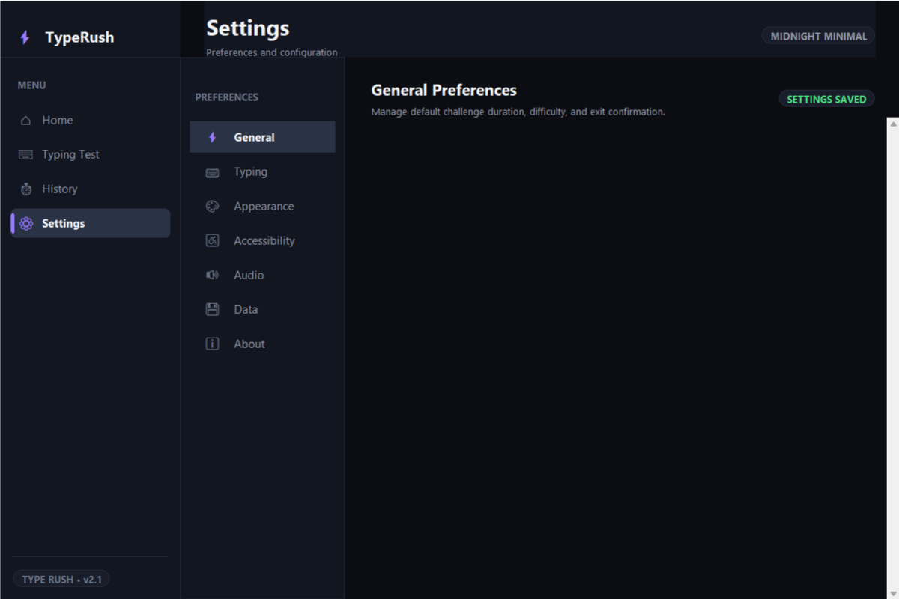

# TypeRush 2.1 — Modern Desktop Typing Speed Test & Performance Analytics

[](https://www.python.org/)
[](https://docs.python.org/3/library/tkinter.html)
[](#)
[](#)
[](#)

A modern, distraction-free desktop typing benchmark and keyboard fluency training application built with pure native Python and the standard Tkinter graphical toolkit. Inspired by Monkeytype's minimalism and typography-first approach, TypeRush combines a high-contrast dark aesthetic (**Midnight Minimal**) with an authoritative continuous text stream, cascade-immune Levenshtein string alignment, and real-time performance telemetry.

---

### Project Team Members (SRM Institute of Science and Technology)
* **Shivansh Bansal** — `RA2511026010332`
* **Biswa Prakash Rout** — `RA2511026010339`
* **Boddupalli Phani Venkata Sri Abhiram** — `RA2511026010355`

**Course:** 21CSC203P – Advanced Programming Practice (APP)  
**Department:** Department of Computational Intelligence, School of Computing  

---

## Table of Contents
1. [Core Features & Architecture](#1-core-features--architecture)
2. [Visual Tour & Working Screenshots](#2-visual-tour--working-screenshots)
3. [Typing Engine & Mathematical Formulas](#3-typing-engine--mathematical-formulas)
4. [Project Structure](#4-project-structure)
5. [Installation & How to Run](#5-installation--how-to-run)
6. [Verification & Automated Testing](#6-verification--automated-testing)
7. [Building Standalone Executable](#7-building-standalone-executable)

---

## 1. Core Features & Architecture

* **Zero External Dependencies**: Engineered strictly using Python's standard library (`tkinter`, `json`, `math`, `time`, `ctypes`, `dataclasses`). Zero third-party web frameworks, zero Electron, zero pip requirements.
* **Continuous Stream & 4 Difficulty Tiers**: Stateful shuffled deck generator featuring curated natural English vocabulary across **Easy**, **Medium**, **Hard**, and **Expert** tiers with rolling exclusion to eliminate repetitions.
* **Cascade-Immune Word-Level Alignment**: Committing a word via Spacebar isolates mistakes to word *N*. Typos never cascade downstream to misalign subsequent words.
* **Instant Tri-State Character Feedback**: Immediate color highlighting:
  * 🟢 **Vivid Green (`#4ADE80`)**: Correctly typed characters.
  * 🔴 **Crimson Red (`#F87171`)**: Typographical error / mismatch.
  * ⚪ **Muted Slate (`#858D9E`)**: Pending untyped text.
* **Native Caret Positioning**: Precise insertion caret synchronized via font bounding-box metrics (`text_display.bbox()`), eliminating cursor jitter and visual artifacts.
* **Comprehensive Performance Analytics**:
  * Real-time Gross WPM, Net WPM, and Accuracy telemetry.
  * Instantaneous velocity spline graph with peak velocity tracking.
  * Standard deviation rhythm consistency analysis.
  * Granular Levenshtein mistake breakdown (Substitutions, Omissions, Insertions).
* **Local Data Persistence**: Atomic, thread-safe JSON persistence (`data/history.json`) preserving chronological session timelines, multi-criteria filtering, and one-click native CSV export.
* **Windows High-DPI Awareness**: Automatic Per-Monitor V2 DPI scaling on Windows 10/11 for razor-sharp typography and canvas borders.

---

## 2. Visual Tour & Working Screenshots

### 1. Home Dashboard
The central command center welcoming users with the **Midnight Minimal** design system, quick-start configuration card (Difficulty: Easy–Expert; Duration: 15s–120s), Personal Best metrics, and the 7-day velocity progression spline.



---

### 2. Active Typing Test — Live Green Character Feedback
As the user types correctly, characters illuminate in vivid green (`#4ADE80`). The interface automatically hides headers and sidebars during tests to ensure zero distractions.



---

### 3. Error Highlighting & Mistake Isolation
When a typo occurs, the incorrect character highlights in high-contrast red (`#F87171`) with a subtle crimson background (`#2E151E`). Crucially, pressing spacebar commits the word and advances the pointer without penalizing subsequent words.



---

### 4. In-Session Word Correction
Typists can freely edit within the active word using Backspace. Characters instantly update their visual tags, reinforcing proper muscle memory before word commit.



---

### 5. Non-Intrusive Safe Exit Experience
Pressing Escape or clicking Exit during a test displays a compact, non-modal confirmation dialog in the top-right corner. The passage and active timer remain visible underneath, allowing typists to either resume typing or safely cancel.



---

### 6. Results & Performance Telemetry
Upon test completion, the application renders the comprehensive Results view featuring dominant Net WPM, accuracy %, an 8-metric telemetry grid, and the instantaneous velocity progression curve.



---

### 7. Word-Level Mistake Diagnostics
Scrolling down the Results screen reveals a granular typographical breakdown categorizing errors into substitutions, omissions, and insertions to pinpoint specific keyboard weaknesses.



---

### 8. Chronological History & CSV Export
The History screen archives all completed sessions grouped by date, featuring multi-tier filters (by difficulty, duration, and speed ranking), personal best milestones, and one-click CSV export.



---

### 9. Customization & Preference Center
Organized into 7 clean categories with a 220px navigation sidebar, allowing users to configure typography sizing (Small 14pt, Medium 18pt, Large 22pt), caret blinking styles, native audio soundscapes, and data backups.



---

## 3. Typing Engine & Mathematical Formulas

TypeRush 2.1 strictly adheres to standardized international typing formulas:

### Gross Words Per Minute (GWPM)
$$\text{Gross WPM} = \frac{\left( \frac{\text{Total Keystrokes}}{5} \right)}{\text{Elapsed Minutes}}$$

### Net Words Per Minute (NWPM)
$$\text{Net WPM} = \max\left(0, \text{Gross WPM} - \frac{\text{Uncorrected Errors}}{\text{Elapsed Minutes}}\right)$$

### Accuracy Percentage
$$\text{Accuracy (\%)} = \left( \frac{\text{Correct Characters}}{\text{Total Keystrokes}} \right) \times 100$$

### Rhythm Consistency
$$\sigma = \sqrt{\frac{1}{N} \sum_{i=1}^N (w_i - \bar{w})^2}, \quad \text{Consistency (\%)} = \max(0, 100 - \sigma \times 4)$$

---

## 4. Project Structure

```text
TypeRush/
├── assets/                    # Native audio effects and icon assets
│   ├── icons/                 # Application icon definitions (app.ico)
│   └── sounds/                # Native 16-bit WAV audio files
├── data/
│   ├── history.json           # Atomic persistent session records
│   └── settings.json          # User preferences
├── screenshots/
│   └── v2.1/                  # 10 official verification screenshots (1200x800)
├── tests/                     # 91 unit and regression tests
│   ├── run_v21_typing_rebuild_demo.py   # Live interactive demo
│   ├── test_v21_improvements.py         # Exit, settings & audio tests
│   ├── test_v21_redesign.py             # Alignment, engine & telemetry tests
│   └── test_v21_typing_rebuild.py       # Spacebar commit & caret tests
├── ui/
│   ├── screens/
│   │   ├── base_screen.py     # Base screen layout & lifecycle hooks
│   │   ├── home_screen.py     # Dashboard & Quick-Start card
│   │   ├── typing_screen.py   # Typography passage & event loop
│   │   ├── results_screen.py  # Results telemetry & velocity graph
│   │   ├── history_screen.py  # History timeline & search/filtering
│   │   └── settings_screen.py # 7-category preference center
│   ├── alignment.py           # Levenshtein string-alignment engine
│   ├── animations.py          # Easing animations & timer scheduler
│   ├── app.py                 # Core application shell & screen router
│   ├── audio_manager.py       # Offline cross-platform audio feedback
│   ├── backgrounds.py         # Midnight Minimal dark canvas surface
│   ├── components.py          # Rounded cards, telemetry pills & buttons
│   ├── content_generator.py   # Stateful curated text deck generator
│   ├── scoring.py             # WPM, accuracy & telemetry equations
│   ├── storage.py             # Atomic JSON persistence & CSV export
│   └── theme.py               # Midnight Minimal color palette & design tokens
├── .gitignore                 # Git ignore specifications
├── build_exe.py               # 1-command PyInstaller standalone packaging tool
├── capture_v21_visuals.py     # Offscreen verification capture engine
├── main.py                    # High-DPI initialization & application entry
└── README.md                  # Project documentation
```

---

## 5. Installation & How to Run

### Prerequisites
* **Python 3.12 or newer** installed from [python.org](https://www.python.org/).
* No `pip install` commands required. TypeRush operates 100% on Python's built-in standard library.

### Clone & Launch
```bash
# 1. Clone the repository
git clone https://github.com/Abhiram1108/TypeRush.git

# 2. Navigate to the project directory
cd TypeRush

# 3. Launch the application
py main.py
```

### Keyboard Shortcuts
* `1`, `2`, `3`, `4`: Quick-select test duration (15s, 30s, 60s, 120s).
* `Return` / `Enter`: Start the test from the dashboard.
* `Tab`: Instant test restart.
* `Escape`: Clean exit / cancellation.

---

## 6. Verification & Automated Testing

TypeRush is verified by 91 automated unit and regression tests covering string alignment, WPM formulas, spacebar commits, and thread-safe persistence:

```bash
# Run all automated test suites
py -m unittest discover tests -v

# Run live 9-test interactive demonstration
py tests/run_v21_typing_rebuild_demo.py

# Verify clean bytecode compilation across repository
py -m compileall .
```

---

## 7. Building Standalone Executable

To package TypeRush into a standalone, single-file Windows executable (`TypeRush.exe`):

```bash
# 1. Install PyInstaller
pip install pyinstaller

# 2. Run the bundled build script
py build_exe.py
```
The compiled executable will be generated in `dist/TypeRush.exe` with bundled icons, sounds, and DPI awareness.

---

## License & Academic Attribution
Developed as an academic project for **21CSC203P — Advanced Programming Practice**, Department of Computational Intelligence, School of Computing, SRM Institute of Science and Technology.
